# Epic 2 · Phase 1 — Confidence Audit: Results

**Question.** Can a model tell the cases where its own answer is solid from the cases where it is on shaky ground; does that ability depend on what it takes to answer the question, once difficulty is held fixed; and do different ways of asking for confidence tell the same story?

**Short answer.** Partly, and it depends heavily on *how* you ask. What models do (agreement across samples, token probabilities) tracks correctness well on every kind of question. What they *say* about their confidence tracks it on factual recall, barely on arithmetic, and not at all on letter-level tasks, even among questions of equal difficulty. Instruction-tuned models state near-certainty almost regardless of difficulty; the base model does not. Told the cost of a wrong answer, models react to *whether* there is a penalty but not to its size.

Plan: [`docs/epic2_phase1_plan_03-11-2026.md`](../../../docs/epic2_phase1_plan_03-11-2026.md). Code and run instructions: [`README.md`](README.md). Every table and figure: [`results/`](results/README.md). Completed 2026-11-08.

## Setup

**Questions (680).** Answerable, with a difficulty knob of five levels × 30 questions: recall (PopQA, by Wikipedia page views; 150), computation (multiplication, 2 × 2 to 4 × 4 digits; 150), perception (letter count, nth letter, reversal, 5 to 15-letter words; 150). Without a proper answer: false premise (a famous work credited to the wrong person; 40), ambiguous title (several works share it; 40), unknowable (unrecorded details, open problems, far future; 75). Forecastable: 75 market questions that resolved after every model's cutoff, with the crowd's forecast as a baseline. Multi-hop and post-cutoff were deferred.

**Ways of asking (16 calls per question).** P plain answer (with token log-probabilities where available: method E); B ten samples at T = 1, agreement with P; A answer then confidence; D confidence first, then answer; C answer only if more than t confident, with Kalai et al.'s scoring stated, at t = 0, 0.5, 0.75, 0.9. Forecasts: a probability, plus ten samples.

**Models (9 configs).** On the 4090: Qwen3-1.7B, Qwen3-8B (thinking off and on), Qwen3-14B, Qwen3-8B-Base (P, B, E only, 5-shot). On Azure AI Foundry: GPT-4o, GPT-5 nano, Grok 4.1 Fast (non-reasoning). Personal key: Claude Haiku 5.5 (thinking off). Phi-4-mini was dropped after the pilot (too slow on Foundry). Cost: about $5.80 on Foundry, $0.30 for Claude; the 4090 runs cost time only.

**Grading.** Code rules first (exact answers, alias matches, bare refusals), then Qwen3-14B as judge with thinking off for everything else. Agreement with hand labels: 114/120 on a reviewed gold set (the original judge managed 77/120), 39/40 on a blind held-out set of Qwen answers, 43/48 on a blind held-out set of API-model answers, where every disagreement had the judge stricter than the hand label. Figure: [`judge_check.png`](results/figures/judge_check.png).

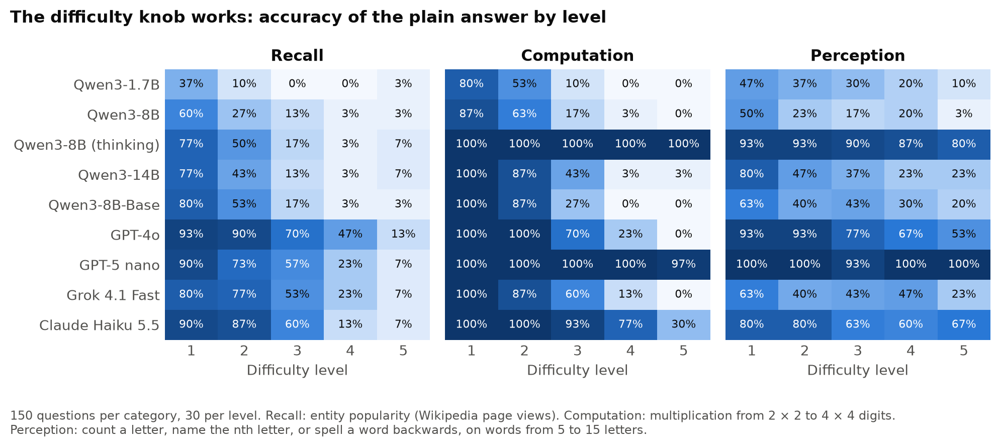

## Findings

### 1. Behaviour knows more than words

Sample agreement (B) and token probability (E) separate right from wrong answers within a difficulty level on every answerable category (within-level AUROC mostly 0.6 to 0.95). Stated confidence does so on recall (A 0.66 to 0.87, D 0.55 to 0.78) and almost nowhere else. When a model states 0.9 or more but half or fewer of its own samples agree, the answer is right only 2% to 28% of the time; that case covers 14% to 50% of answered questions for every model except GPT-5 nano. The reverse (states low, samples agree) is at most 1%.

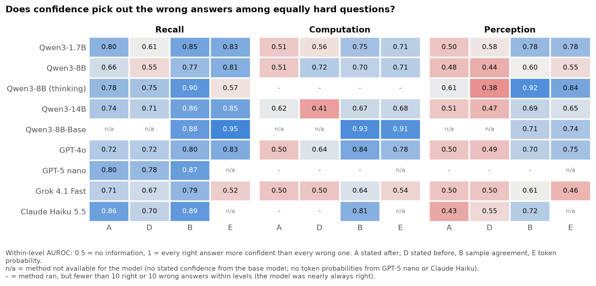
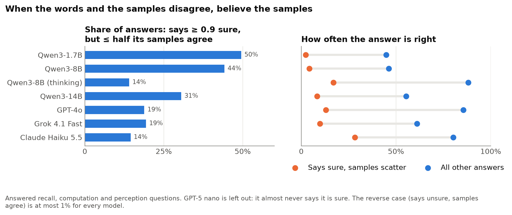

### 2. The category matters, not just the difficulty

Plain AUROC mixes two things: knowing which *kinds* of question are hard, and knowing which particular answers are wrong. Within-level AUROC and a regression with a fixed effect for every model × category × level cell keep only the second. Perception is worse than recall for **every** method (log-odds slope difference: A −6.5 [−10.6, −4.2], D −6.1, B −3.1, E −1.8, C −2.1; all intervals exclude 0), and stated confidence on perception has no signal at all (A +0.7 [−1.6, 2.4], D −0.4 [−1.3, 0.7]). Computation sits in between: much of its plain AUROC was level tracking (Qwen3-8B D 0.94 → 0.72, GPT-4o B 0.97 → 0.84), and after answering, no model's stated confidence separates its right and wrong products within a level.

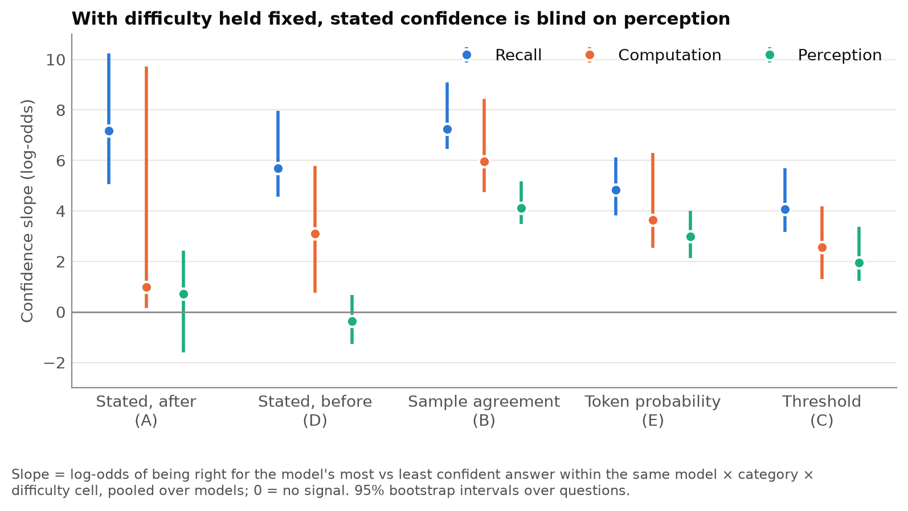
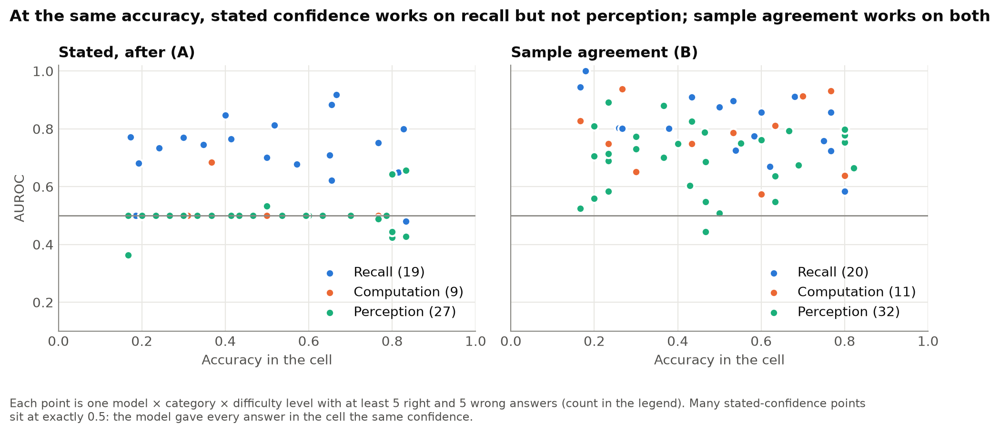

### 3. The hard–easy effect is one-sided, and it is in the words

Instruction-tuned models' stated confidence hardly moves with difficulty (sensitivity of A to accuracy ≈ 0 on computation and perception for GPT-4o, Grok, Qwen3-8B and 14B). They look calibrated on easy questions only because they are right there, and are overconfident by up to 1.0 on the hardest (GPT-4o and Grok on 4 × 4-digit products: 0% accurate, confidence 1.0). There is no underconfidence on easy items, the other half of the classic effect. Sample agreement and token probability follow difficulty (sensitivity mostly 0.5 to 1.0). GPT-5 nano is the one underconfident model (−0.1 to −0.2 on computation and perception, where it is nearly always right).

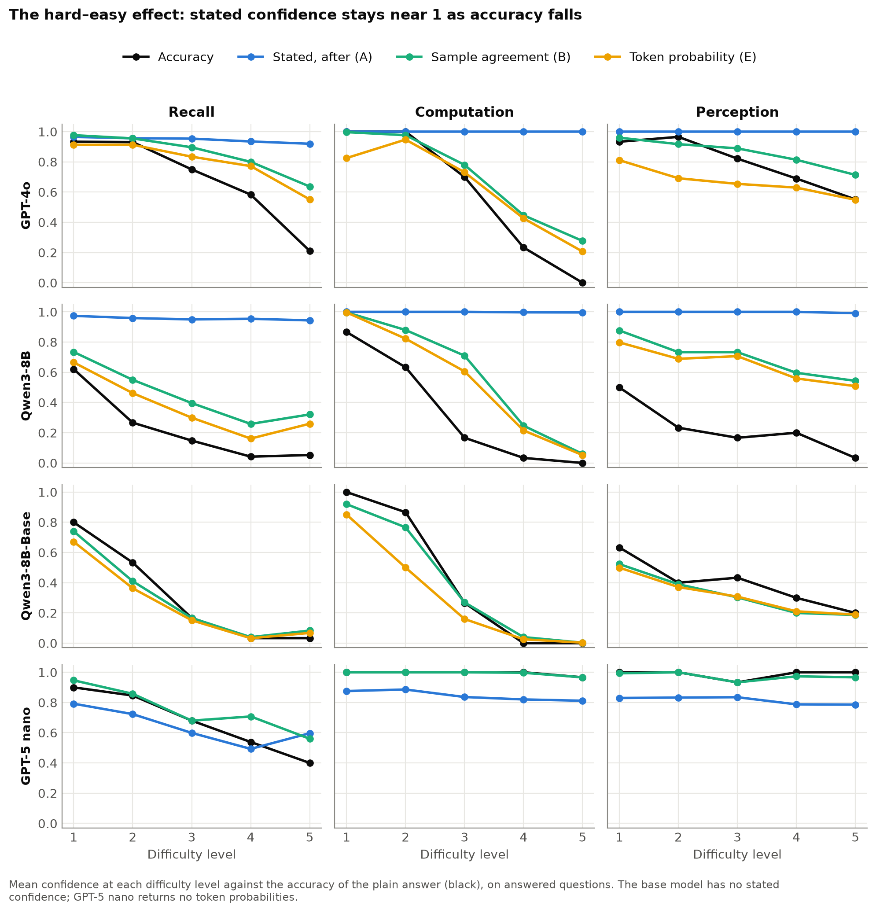

### 4. The base model is the best calibrated

Qwen3-8B-Base, prompted few-shot, has token-probability AUROC 0.98 on recall and 0.99 on computation (within-level 0.95 and 0.91), and its confidence follows difficulty (sensitivity 0.73 to 0.88, overconfidence between −0.15 and +0.05 at both ends). This is Kalai et al.'s prediction: pre-training yields calibrated probabilities, post-training erodes them. One caveat: E is the probability of the whole answer string, so a correct long number gets a low value and the base model looks underconfident on computation.

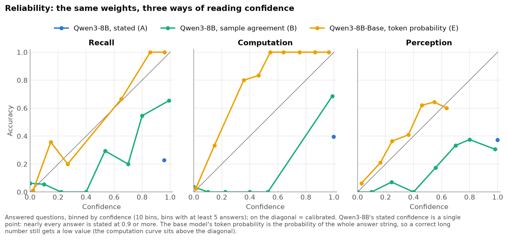

### 5. Before vs after answering: no general winner

Paired on the same questions, within levels, and with Claude Haiku's worked-out replies removed, confidence asked before answering (D) beats confidence after (A) on computation for Qwen3-8B (+0.21 [0.08, 0.34]) and GPT-4o (+0.14 [0.02, 0.24]), loses for Qwen3-14B (−0.21) and for Qwen3-8B thinking on perception (−0.24), and on recall A is as good or better (Haiku −0.15, Qwen3-1.7B −0.17, Qwen3-8B −0.13). The early impression that "before beats after" was mostly level tracking. Phase 1B tests the same question on hidden states instead of words.

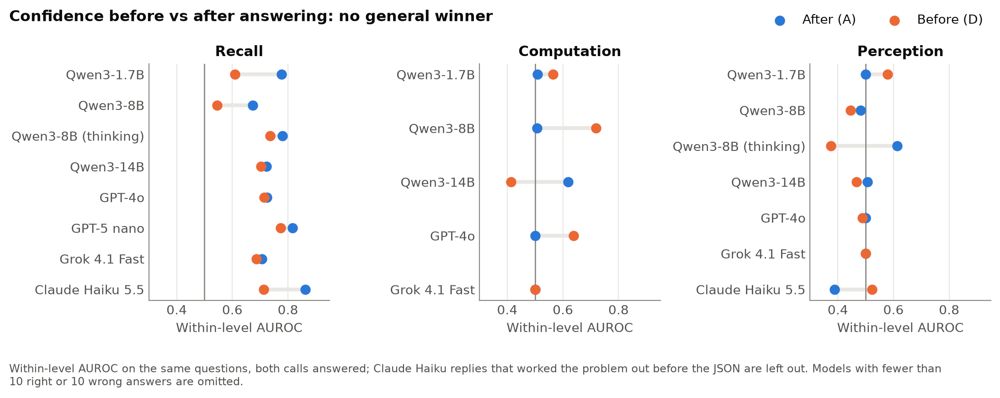

### 6. Questions without a proper answer

Unknowable questions are easy: 84% to 100% abstain. False premises and ambiguous titles separate the models: Claude Haiku corrects every false premise and asks which work is meant on 75% of ambiguous titles; GPT-5 nano manages 42% and GPT-4o 22% on ambiguous titles; everything else mostly picks one work. Stated confidence means different things here: after responding, GPT-4o, Grok and Qwen3-8B/14B rate their abstention on an unknowable question at 0.85 to 1.0 ("confident it can't be known"), while Haiku, GPT-5 nano and Qwen3-1.7B rate it low; asked before answering, every model's confidence falls when it is about to abstain (GPT-4o: 0.12 vs 0.80 when it commits).

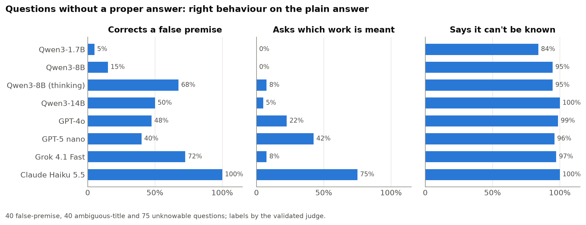
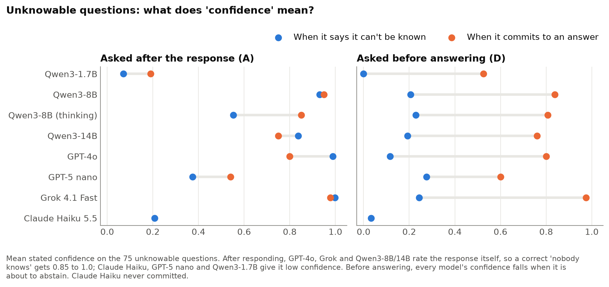

### 7. Stating the stakes: models react to a penalty, not to its size

With Kalai et al.'s threshold rule in the prompt, answer rates fall from t = 0 to t = 0.5 and then stay flat through 0.75 and 0.9; a model following the rule would abstain more as t rises. The penalty changes behaviour in other ways: Claude Haiku shows its working instead of abstaining (computation replies with worked steps: 12% at t = 0, 76% at t = 0.9; accuracy 0.82 → 1.00), and on false premises the penalty turns corrections into refusals (Haiku abstains on 0% of plain answers, 60% at t = 0.9; most Qwen configs stop correcting the premise altogether).

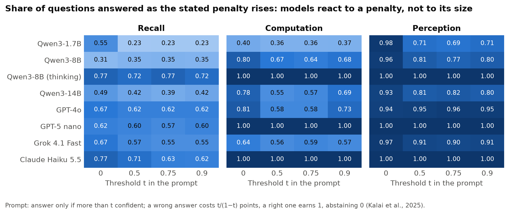
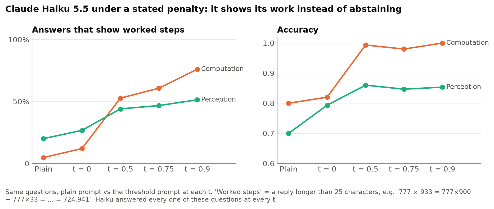

### 8. Forecasting, reported apart

No model beats always guessing the base rate (Brier 0.227): Claude Haiku 0.243, GPT-4o 0.252, the rest 0.26 to 0.31, against the crowd's 0.190. The loss is mostly calibration (Murphy reliability 0.05 to 0.12, crowd 0.03); discrimination is weak too (AUROC 0.50 to 0.61, crowd 0.74). Averaging the ten samples helps slightly (Haiku 0.232).

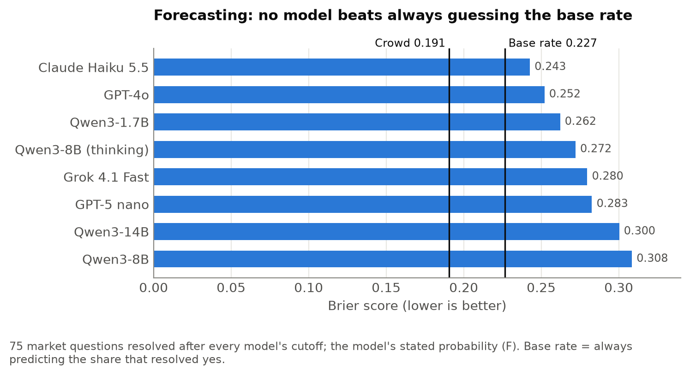

## Caveats

- **Claude Haiku works problems out before its JSON** in A and D (86% / 73% of computation replies), against the prompt's "Reply with only a JSON object". Its A/D accuracy on computation is 1.00 against 0.80 for the plain answer, its D there is not confidence *before* answering, and a clarification inside the working is not seen by the judge (its A/D ill-posed rates are understated; P is unaffected). Flagged per row and left out of the before/after comparison.
- **Too few errors to measure:** GPT-5 nano and Qwen3-8B thinking on computation and perception; Haiku A/D on computation. AUROC is only reported with at least 10 right and 10 wrong answers.
- **One confidence for everything:** GPT-4o and Grok often give every answer in a cell the same confidence, which pins AUROC at exactly 0.5 and makes the A slope on computation unstable (interval +0.16 to +9.71).
- **meta-d′ was not used:** it needs a two-choice task; open-ended answers have no type-1 d′. Accuracy is controlled by within-level comparison and the regression instead.
- **Single runs**, one prompt wording per method, 30 questions per cell; intervals are bootstrap over questions, not over prompts or seeds.

## Go / no-go for the sprint

**Go, as a strong candidate.** The audit produced findings that are specific, robust to the difficulty control, and not in the papers we read: the gap between behavioural and stated confidence per category (finding 1–2), the one-sided hard–easy effect confined to stated confidence (3), and models that react to a penalty but not its size (7). The pipeline (task, rules + validated judge, analysis) is reusable for any model in an afternoon. The natural sprint extensions are the deferred multi-hop and post-cutoff categories, paraphrase robustness of the stated-confidence results, and Phase 1B's internal-state probes. The final choice of sprint problem waits for Phases 2–4, as planned.
