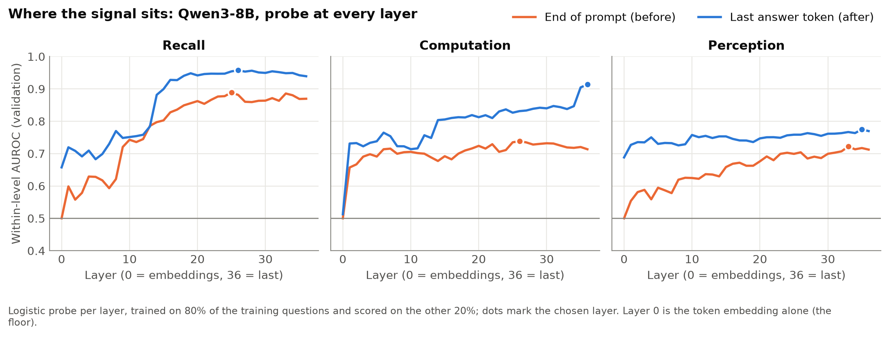
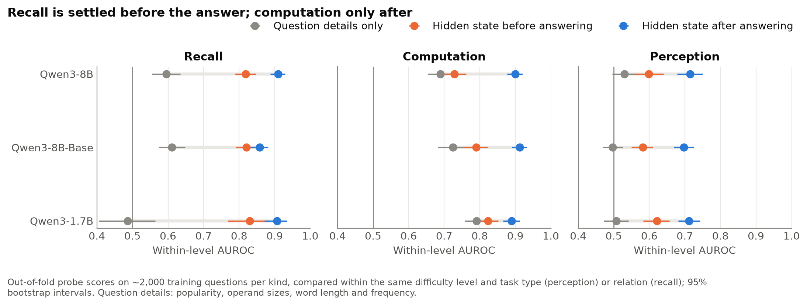
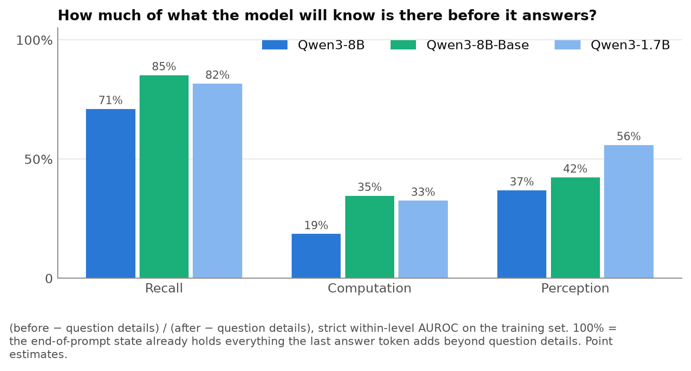
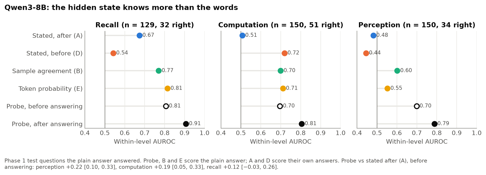
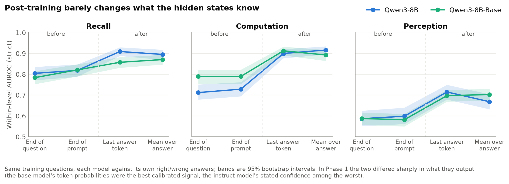
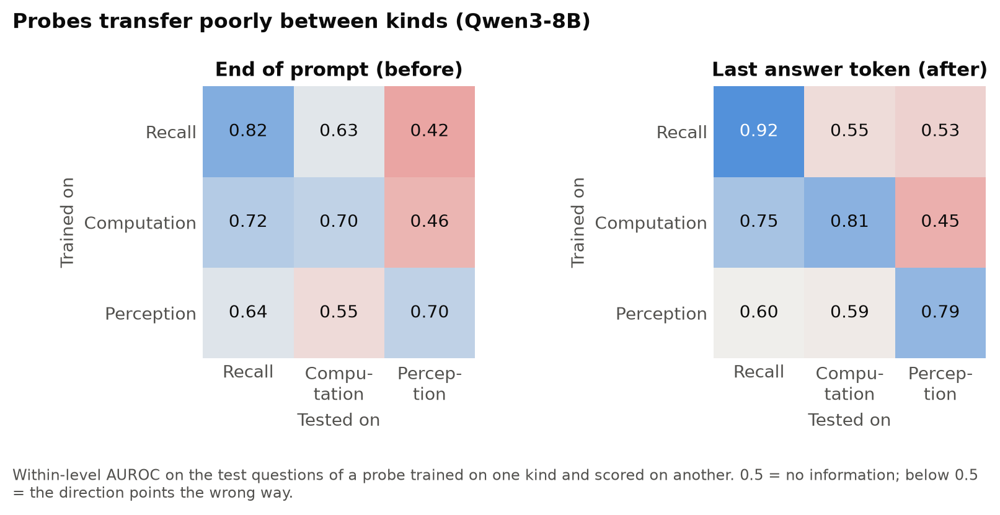

# Epic 2 · Phase 1B — Probing Internal Confidence: Results

**Question.** Before a model answers, does its hidden state already carry a signal of whether the answer will be right, and does that depend on what the question takes (recalling a fact, computing a product, reading letters)? And does the representation know more than what the model says?

**Short answer.** Yes, and it depends on the kind of question exactly as predicted. On **recall**, most of the signal is there before the model writes anything, and well beyond what the question's popularity predicts. On **computation**, the state before answering knows little more than "bigger numbers are harder"; the signal appears once the answer is written. The hidden state beats the model's stated confidence on every kind, and on perception it beats sample agreement and token probability too. Post-training leaves this representation largely intact: base and instruct models know about the same internally, though in Phase 1 they differed sharply in what they *output*.

Plan: [`docs/epic2_phase1b_plan_08-11-2026.md`](../../../docs/epic2_phase1b_plan_08-11-2026.md). Phase 1: [`RESULTS.md`](RESULTS.md). Code: [`README.md`](README.md) (Phase 1B section). Completed 2026-11-08.

## Setup

**Models (4090, bf16, HF transformers).** Qwen3-8B (thinking off), Qwen3-8B-Base (5-shot), Qwen3-1.7B.

**Questions.** *Test set:* the Phase 1 questions (150 recall, 150 computation, 150 perception, plus 75 unknowable and 80 ill-posed), so every number sits next to Phase 1's methods on the same answers. *Training set:* 5,995 new answerable questions from the same generators, none overlapping the test set (2,000 recall, 2,000 computation, 1,995 perception), answered with the plain prompt (P) and graded by the same rules and judge. Training accuracy by level matches the test set closely, except recall level 1 (only 21 training questions left after excluding the test subjects).

**States.** One forward pass over the P prompt plus the model's own logged answer; at every layer, four positions: end of the question, end of the prompt (the state from which the first answer token is predicted: **before**), last answer token (**after**), and the mean over the answer.

**Probes.** Logistic regression (standardised, L2, balanced class weights) per model, kind, position and layer. The layer is chosen on a 20% validation split of the training set, the regularisation by 5-fold cross-validation; the test set is never used for a choice. Label: the plain answer is right (1) or wrong or an abstention (0).

**Scores.** Within-level AUROC, as in Phase 1: right/wrong pairs compared only within a difficulty level. *Strict* also splits by task type (perception: count / nth letter / reverse) or relation (recall: director, author, ...), because a probe given only the question's details (popularity, operand sizes, word length and frequency, task type) already reached 0.70 to 0.79 within a level on perception and computation for Qwen3-8B-Base and Qwen3-1.7B. The test set has 32 to 64 right answers per model and kind, too few to separate before from after, so the probe-only comparisons use **out-of-fold scores on the training set** (5-fold, ~2,000 questions per kind; each question scored by a probe that never saw it). The test set is used for the comparison with Phase 1's A, D, B, E.

**Controls.** The question-details probe (above); shuffled labels (0.30 to 0.64 on the test set, the lowest on Qwen3-1.7B recall with 15 right answers); layer 0, the token embedding alone, which at the end of the prompt is exactly 0.50 (the same token for every question); and Ni et al.'s MLP (512-64-32) at the chosen layer, which matches the logistic probe (mean within-level AUROC 0.83 vs 0.82 on the test set; differences within ±0.10).

## Findings

### 1. Recall is settled before the answer; computation only after

Out-of-fold, strict within-level AUROC, 95% intervals:

| | Question details | Before | After | Before − details | After − before |
| --- | --- | --- | --- | --- | --- |
| Qwen3-8B, recall | 0.60 | 0.82 | 0.91 | **+0.22** [0.18, 0.27] | +0.09 [0.06, 0.12] |
| Qwen3-8B, computation | 0.69 | 0.73 | 0.90 | +0.04 [0.00, 0.08] | **+0.17** [0.14, 0.20] |
| Qwen3-8B, perception | 0.53 | 0.60 | 0.72 | +0.07 [0.02, 0.11] | +0.12 [0.08, 0.15] |
| Qwen3-8B-Base, recall | 0.61 | 0.82 | 0.86 | **+0.21** [0.17, 0.25] | +0.04 [0.02, 0.06] |
| Qwen3-8B-Base, computation | 0.72 | 0.79 | 0.91 | +0.07 [0.03, 0.10] | **+0.12** [0.09, 0.16] |
| Qwen3-8B-Base, perception | 0.50 | 0.58 | 0.70 | +0.08 [0.05, 0.12] | +0.12 [0.08, 0.15] |
| Qwen3-1.7B, recall | 0.49 | 0.83 | 0.91 | **+0.34** [0.26, 0.43] | +0.08 [0.03, 0.13] |
| Qwen3-1.7B, computation | 0.79 | 0.82 | 0.89 | +0.03 [0.00, 0.06] | +0.07 [0.04, 0.10] |
| Qwen3-1.7B, perception | 0.51 | 0.62 | 0.71 | +0.11 [0.07, 0.16] | +0.09 [0.05, 0.13] |

Of what the state after answering knows beyond the question's details, 71% to 85% is already there before answering on recall, 19% to 35% on computation and 37% to 56% on perception. Before generation, whether the model holds a fact is decided; whether its multiplication will come out right is not, beyond what the operand sizes say. Ni et al. found before ≈ after on factual QA (NQ, HotpotQA), which matches the recall rows; they had no computation set.

### 2. The hidden state knows more than the words

Test set, Qwen3-8B, within-level AUROC on the questions the plain answer answered:

| | Probe before | Probe after | A (stated) | D (stated before) | B (samples) | E (token prob.) |
| --- | --- | --- | --- | --- | --- | --- |
| Recall | 0.81 | 0.91 | 0.67 | 0.54 | 0.77 | 0.81 |
| Computation | 0.70 | 0.81 | 0.51 | 0.72 | 0.70 | 0.71 |
| Perception | 0.70 | 0.79 | 0.48 | 0.44 | 0.60 | 0.55 |

Even before answering, the probe beats stated confidence on perception (+0.22 [0.10, 0.33]) and computation (+0.19 [0.05, 0.33]); after answering it beats it on all three kinds (+0.22 to +0.31) and beats sample agreement on perception (+0.19 [0.07, 0.31]) and recall (+0.14 [0.04, 0.25]). Qwen3-1.7B shows the same pattern (probe after vs A: +0.38 computation, +0.39 perception). Phase 1 found stated confidence carries no information on perception; the information is in the model, and the words don't use it. This is Kalai et al.'s latent-vs-output point measured directly.

The base model has no stated confidence; its probe after answering is level with its token probability and sample agreement on recall and computation (−0.05 to +0.06) and above both on perception (+0.13 [0.03, 0.22] vs B, +0.10 [0.02, 0.19] vs E); before answering it falls behind them on computation (−0.20 [−0.41, −0.04] vs E), as finding 1 predicts.

### 3. Post-training barely changes what the hidden states know

Base minus instruct, same training questions, each model against its own answers (strict): after answering, computation +0.01 [−0.02, 0.04], perception −0.02 [−0.06, 0.02], recall −0.05 [−0.08, −0.02]; before answering, the base model is ahead only on computation (+0.06 [0.02, 0.11]). In Phase 1 the two differed sharply in what they *output*: the base model's token probabilities were the best-calibrated signal in the study, the instruct model's stated confidence among the least informative. So post-training damages the output's use of the information, not the information.

### 4. Each kind has its own direction

A probe trained on one kind transfers poorly to another (Qwen3-8B, test set): recall-trained probes score 0.42 (before) and 0.53 (after) on perception; perception-trained 0.55 to 0.64 elsewhere. Computation-trained probes carry some signal to recall (0.72, 0.75), not the reverse (0.63, 0.55). A probe trained on all three kinds pooled nearly matches the per-kind probes (Qwen3-8B before: 0.81 / 0.72 / 0.73 vs 0.82 / 0.70 / 0.70), so the directions coexist rather than conflict. There is no single "I know this" direction.

### 5. Where the signal sits

For Qwen3-8B, recall's after-answer signal rises sharply at layers 13 to 15 of 36 and plateaus; for both 8B models the chosen recall layers sit about two-thirds of the way up (19 to 26). Computation's after-answer signal climbs to the very last layer (layer 36 for both 8B models), where the state at the last answer token predicts the next token; part of that signal may be the output distribution itself (how sure the model is that the answer has ended), which E reads from outside.

## Caveats

- **After-answer states see the answer.** The last answer token and the mean over the answer encode what was answered, not only how sure the model is; a probe can learn that some answers are more often right (a well-known name, a small count). The token embedding alone (layer 0) at those positions reaches 0.45 to 0.88 on validation, so part of the after signal is the answer itself. The before-answer results, the key test here, have no such issue.
- **Training-set scores are slightly optimistic.** The layer was chosen on 20% of the same training data; the bias is shared by all positions, so it barely affects before vs after.
- **Few right answers in places.** Qwen3-1.7B has only 68 right recall answers in training and 15 in the test set; its recall intervals are wide.
- **Abstention, tentative.** On unknowable questions, a low before-answer score predicts abstention for Qwen3-1.7B (AUROC 0.95 [0.89, 0.99]; 63 abstain, 12 answer). The other cells have too few questions on one side (Qwen3-8B answers 4 of 75 unknowable questions; Qwen3-1.7B abstains on 3 of 80 ill-posed) and are not reported as findings.
- **One prompt, one run, open models of 1.7B and 8B only.** The thinking configuration has no clean "after" position and Qwen3-14B does not fit in bf16; neither was probed.

## Predictions (written before the runs) vs outcome

| Prediction | Outcome |
| --- | --- |
| Recall: before ≥ 0.7 and within 0.05 of after | Before 0.82 to 0.83 (strict). Gap 0.04 for the base model, 0.08 to 0.09 for the instruct models: **partly** |
| Computation: before clearly below after | **Yes**: +0.07 to +0.17, every interval above 0; before is barely above question details |
| Probe ≥ stated confidence on every kind; ≈ B, E on recall | **Yes** after answering; before answering on computation and perception. On recall the probe after is above B (+0.14 [0.04, 0.25]) and slightly above E (+0.09 [0.01, 0.20]) |
| Base model's probe at least as good as the instruct model's | **Level**, not better, except before answering on computation: the finding is that the representation survives post-training |
| Weak transfer between kinds | **Yes** |

## For the sprint

Phase 1B adds the mechanistic half to Phase 1's behavioural audit: the question category decides *when* a model can know it is wrong, and post-training breaks the link between what the model knows and what it says, not the knowing. Natural extensions: steering along the probe direction to see whether the stated confidence follows (does the output *ignore* the signal, or never read it?); probing the thinking model during its reasoning (does the computation signal appear step by step?); larger open models; and the API-model behavioural proxies against a probe trained on an open model of similar accuracy.
