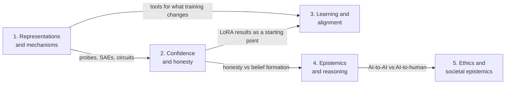

# Synapses: epic structure

Agreed 2026-11-22. Synapses is organised around five epics, each answering one research question. This file sets their boundaries; detailed phases and timelines live in each epic's own plan, and for Epics 3 to 5 they are deliberately not fixed yet.

## The epics

| Epic | Research question | Status | Plan |
| ---- | ----------------- | ------ | ---- |
| 1. Representations to mechanisms | How do neural networks encode information and implement computation? | Paused (2026-11-03) | [`epic1_plan_12-07-2026.md`](epic1_plan_12-07-2026.md) |
| 2. Confidence and honesty | Does an LLM know what it knows, and communicate it faithfully? | Active | [`epic2_plan_03-11-2026.md`](epic2_plan_03-11-2026.md) |
| 3. Learning and behavioural alignment | How do training objectives shape representations, reasoning and behaviour? | Proposed | not yet |
| 4. Epistemics and reasoning | How do AI systems form, revise and justify beliefs? | Proposed | not yet |
| 5. AI ethics and societal epistemics | How does AI affect human knowledge, autonomy and society? | Exploratory | not yet |

## Epic 1: Representations to mechanisms

- Phase 1: Variational autoencoders. Complete ([`RESULTS.md`](../experiments/epic1/phase1_vae/RESULTS.md)).
- Phase 2: Self-supervised learning. Partly complete: SimCLR, SimSiam and VICReg done; the comparison, I-JEPA and the close-out remain.
- Phase 3: Sparse autoencoders and feature discovery.
- Phase 4: Mechanistic interpretability and circuit analysis.

Epic 1 provides techniques the other epics reuse. To make them carry over, Phases 3 and 4 should move onto small LLMs (for example Qwen3-1.7B) early rather than stay on MNIST.

## Epic 2: Confidence and honesty

- Phase 1: Confidence audit. Complete.
- Phase 1B: Internal-state probing. Complete.
- Phase 2: Apart AI x Epistemics sprint. Submitted 2026-11-16 ("Words in the model's mouth").
- Phase 3: Dissemination. The lifeandtimes blog series on Phase 2, plus publishing the Phase 1B post. Write-up only, no new experiments.
- Phase 4: Replication and further validation. More runs per model, more prompt wordings, fine-tuning on Qwen3-8B, a "verify, then rate" test. This is the route to a publishable paper.
- Phase 5: Sycophancy and honesty evaluations, including MASK.

The immediate priority is Phase 3: consolidating the work already done rather than launching another major experiment. Phase 3 and Phase 4 are kept separate so the blog does not wait on new experiments.

## Epic 3: Learning and behavioural alignment

The previously deferred reinforcement-learning avenue. Candidate phases:

1. Foundations of reinforcement learning.
2. Policy gradients, actor-critic methods and PPO.
3. LLM post-training: SFT, RLHF and DPO.
4. Reasoning-oriented reinforcement learning.
5. How post-training changes internal representations and behaviour.

Phases 1 and 2 are learning phases (like Epic 1's VAE): they build skill rather than findings. On the 4090, SFT and DPO with LoRA on 1.7B to 8B models are feasible, full RLHF with a reward model is marginal, and GRPO-style reasoning RL is feasible on small models with verifiable (for example maths) rewards. Natural starting points: the Epic 2 LoRA experiments, and the Phase 1B finding that base and instruct models look alike internally.

## Epic 4: Epistemics and reasoning

Beyond confidence and honesty, into how AI systems acquire and reason about knowledge. Candidate phases:

1. Belief formation and evidence integration.
2. Belief revision under conflicting evidence.
3. Faithfulness of reasoning and chain of thought.
4. Consistency and coherence of beliefs across contexts.
5. Collective epistemics and multi-agent deliberation.

## Epic 5: AI ethics and societal epistemics

A reading, thinking and writing epic to begin with, not an experimental one. Candidate areas: human epistemic dependence on AI; intellectual autonomy and agency; concentration of AI power; democratic oversight and transparency; competing visions of AGI and their societal implications. There is no need to force it into a technical project yet.

## Boundary rules

- **Epic 2 vs Epic 4.** Epic 2 asks whether the model's *report* matches its internal state (metacognition, truthful communication). Epic 4 asks how that *state* is formed and changed.
  - MASK (stated vs actual belief) is Epic 2.
  - Sycophancy is split. Caving to social pushback while still holding the original belief is honesty, so Epic 2 Phase 5. Updating properly on genuine counter-evidence is belief revision, so Epic 4 Phase 2. Running both on the same items is a natural shared experiment.
  - Chain-of-thought faithfulness stays in Epic 4 (how reasoning produces beliefs), though it borders on Epic 2's "honesty about process". The sprint result that reasoning models do check the answer in their turn links the two.
- **Epic 1 vs Epic 3.** Epic 1 owns the tools (probes, SAEs, circuit analysis); Epic 3 owns the question of what training changes. Epic 3 Phase 5 applies Epic 1's tools.
- **Epic 4 vs Epic 5.** AI-to-AI deliberation is Epic 4 (experimental). AI-to-human and society-level effects are Epic 5 (reading and writing).

## Outside the epics

- **External engagement** (SPAR, MATS, Apart, Anthropic and other research organisations) is a parallel career and collaboration track that can draw on any epic.
- **Evaluation infrastructure** (Inspect-based tasks, judges, gold sets) is shared tooling, built as each epic needs it, not a phase of any one epic. Reusable code goes in `src/synapses/` as usual.

## Open

- Order of work after Epic 2 Phase 3: resume Epic 1, or keep one active epic at a time. Not decided.
- Detailed phases and timelines for Epics 3 to 5.
